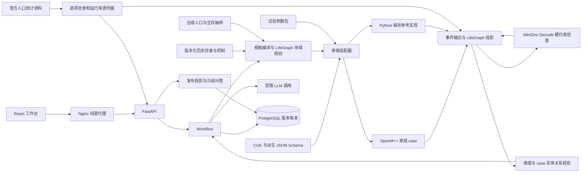
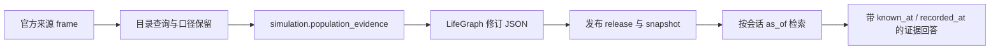
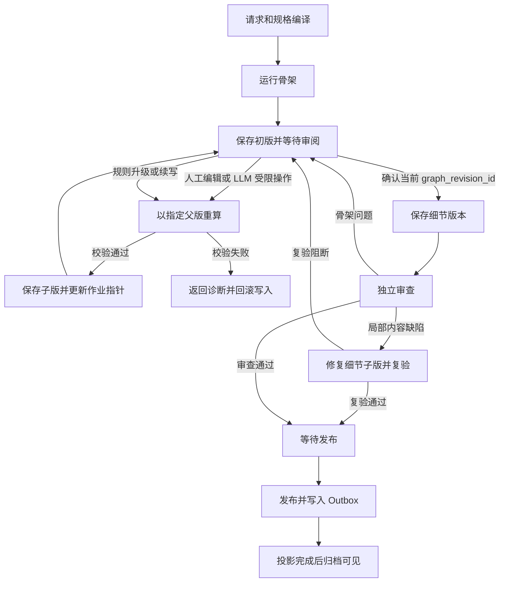
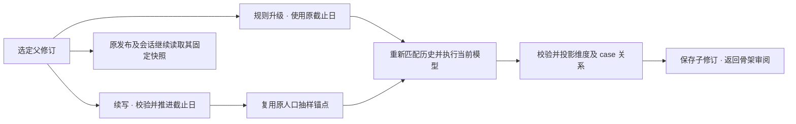
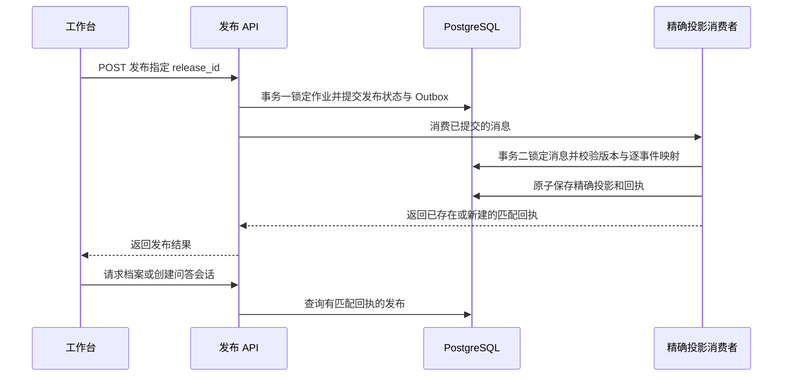

# 数字人生技术架构与骨架 DSL 实现说明

工作台提交生成选项，后端将选项编译为结构化骨架规格，匹配历史目录并执行单个家庭 case。每次生成、编辑、规则升级和续写都可产生独立下载的 LifeGraph 修订，随图保存维度账本、case 实体与关系投影及仿真凭据。用户确认具体修订后，系统才生成细节、审查并发布。发布绑定骨架、细节和快照，数字人问答在该版本和请求时点内检索。

Compose 后端使用 CUE 0.17.1 校验交换规格，以 OpenM++ 1.17.15 执行受信任的 case-based 模型，以 MiniZinc 2.10.1 的 Gecode 求解器检查硬约束，并使用 PostgreSQL 17 保存作业、修订与发布。Python 参考实现用于本地运行和对照。人口资料保留官方统计的原始时点与分母，个体人口抽样、事件风险率和状态量表仍使用合成规则。转移率、存活截面权重及问卷适用性仍需独立验收。 [骨架选型与验收报告](v3/骨架生成DSL与仿真平台选型报告_2026-11-20.html#poc) · [统一契约](v3/全链路设计复核与统一契约.md)

## 1. 组件和数据边界



| 组件 | 职责与入口 |
| --- | --- |
| React、TypeScript、Vite、Nginx | 接收生成选项，恢复作业，提供分类时间线、事件关系图、维度账本、修订与演进、归档和限定视角的问答。Nginx 同源转发 `/api`。 [前端入口](../frontend/src/App.tsx) · [代理配置](../frontend/nginx.conf) |
| FastAPI、Pydantic | 处理请求字段、基础值域和 HTTP 边界。`Workflow` 推进作业，调用领域规则、仿真、细节生成和审查。 [API](../backend/app/main.py) · [请求模型](../backend/app/schemas.py) · [工作流](../backend/app/workflow.py) |
| CUE、历史目录、参数包 | CUE 声明交换结构。历史目录和机制库提供时空适用条件、来源、暴露渠道与制度门槛。试验参数包提供候选年速率。 [CUE](../backend/app/data/skeleton_spec.cue) · [历史目录](../backend/app/data/world_rules.json) · [机制库](../backend/app/data/history_mechanisms.json) · [参数包](../backend/app/data/process_parameters.json) |
| 仿真及领域投影 | Python 固定 case 输入，运行指定引擎，读取事件并投影 LifeGraph。事件依赖、时间、参与者和修改约束由领域层复核。 [仿真适配器](../backend/app/skeleton.py) · [领域规则](../backend/app/domain.py) |
| 人口入口与约束求解 | 合成人口模型按进入条件抽样出生年、风险类和死亡时间。MiniZinc 对共享照护及显式资源预约检查可行性。 [人口模型](../backend/app/population.py) · [约束检查](../backend/app/skeleton_constraints.py) |
| LifeGraph 投影 | 从事件和人物资料派生维度、参与者角色和增量、case 内实体与关系，随修订保存。 [维度账本](../backend/app/dimensions.py) · [实体与关系](../backend/app/case_entities.py) · [产物读写](../backend/app/artifacts.py) |
| PostgreSQL、SQLAlchemy | 保存规格、作业、事件轨迹、图与细节修订、审查和发布。写操作使用事务，测试可以注入 SQLite。 [数据库模型](../backend/app/db.py) · [产物读写](../backend/app/artifacts.py) |
| Outbox、精确检索与问答 | 按发布版本构建事件位置投影及回执。问答从锁定的发布版本获取可见事件和细节，以指定角色范围生成回答。 [发布投影](../backend/app/outbox.py) · [问答服务](../backend/app/chat.py) |

## 2. CUE 骨架规格和 JSON 交换

`POST /api/generations/spec/validate` 返回编译结果及 `exchange` 校验凭据。生成入口 `POST /api/generations` 从同一组选项重新编译并保存规格。输入模型检查日期、枚举、种子及额外字段，领域编译器确认目录编码、时序和存活入口，并在省略出生年或家庭范围时按种子抽样。`sampling` 记录 `provided` 或 `sampled`，出生年抽样还保存候选范围。`history_selection` 保存自动匹配的规则编号、标签和理由，`themes` 保存对应的规则编号序列。 [生成入口](../backend/app/main.py) · [规格编译](../backend/app/domain.py)

骨架适配器在引擎执行前校验完整规范化规格。`#SkeletonSpec` 关闭顶层和各嵌套结构，声明必填字段、枚举、编码形态和两项出生年范围。CUE 文件经 `cue def --out jsonschema` 导出 Draft 2020-12。配置 `CUE_BIN` 时，运行器把规范化 JSON 从标准输入传给 `cue vet`，实际使用派生的交换模式，并将模式 SHA-256 和 `cue-json-schema` 记入运行凭据。原生 Python 环境可使用输入模型与领域层，凭据标为 `pydantic-domain`。 [CUE 源文件](../backend/app/data/skeleton_spec.cue) · [JSON Schema](../backend/app/data/skeleton_spec.schema.json) · [运行校验](../backend/app/skeleton.py)

地区或民族编码是否登记、日期是否为有效日历日期、出生年是否早于截止时点，以及图引用和跨对象时间关系，由目录和领域验证器判定。种子上限 `2^63−1` 由 API 输入模型精确检查，交换模式声明种子为非负整数。

`synthetic-population/1` 使用分段年龄死亡风险和出生风险类。在出生队列中，`life_status: auto` 允许由抽样决定截止时点的存活状态。`living_at_as_of` 或显式 `living` 使用条件存活分布，显式 `deceased` 使用截止日前死亡的截断分布。规范化规格记录 `death_date` 和 `population`，包括出生年与风险类选择概率、入样概率、队列存活概率及 `right_censored`。目前 `frame_population_size` 与 `analysis_weight` 为 `null`。 [人口模型](../backend/app/population.py) · [请求模型](../backend/app/schemas.py) · [人口条件测试](../backend/tests/test_population.py)

### 官方人口统计与合成入口

`official-population-evidence/1` 保存五套来源各自发布的统计口径。`GET /api/catalog` 返回来源元数据和来源特有的类别，图修订的 `simulation.population_evidence` 保存所选地区和类别对应的可用边际观测及联合观测。各观测包含人数、分母、占比、参考日期、地理口径、抽样口径和表号。原表的零人数保存为 `0`，无交叉数据的组合标为 `unavailable`。 [统计资料](../backend/app/data/population_evidence.json) · [目录和查询](../backend/app/evidence_data.py) · [口径测试](../backend/tests/test_evidence_data.py)

| 来源 | 统计口径 |
| --- | --- |
| 大陆七普 2020 | 表 1-4 的 31 个省级地区 × 58 个类别，包含 56 个民族类别以及未识别、入籍类别。分母为原表直接登记的 1,409,778,724 人。 |
| 香港 2021、澳门 2021 | 香港表 2.5 按自我认定的种族分类，澳门表三按血缘定义的族裔分类。长问卷分别按各自普查口径估计或推算，分母为 7,413,070 和 682,070。 |
| 台湾 2020 | 常住人口表分母为 23,829,897，族别联合观测为空。独立的 2020 年 11 月原住民族户籍登记表提供 17 个类别，含尚未申报分类，分母为 576,374。 |

生成规格可通过 `population_frame` 选择公开统计框。地区和族别留空时按所选统计框的正计数联合抽样，也可限定其中一项。导出的 `simulation.population_selection` 保留中选单元人数、筛选后分母和抽样概率。该概率对应来源表的统计时点和分类。出生年、风险类与死亡时间依 `synthetic-population/1` 抽样，过程年速率来自 `synthetic-case-2026.11.1`。出生地与迁移史仍需独立证据，`analysis_weight` 留空。 [抽样实现](../backend/app/population.py) · [官方统计框](../backend/app/evidence_data.py) · [工程速率包](../backend/app/data/process_parameters.json)



### 历史时空候选与个人证据

历史目录 `world-v3.0.1` 和机制库 `historical-mechanisms-v1.0.0` 按相同的 69 个规则编号校验。目录记录版本、地区、有效窗口、年龄和来源。后台把规则窗口、人物适龄窗口与生命截止点相交，将命中结果保存为背景候选。每个节点的 `historical_assessment` 带有机会、资格、各暴露渠道、资格／供给／执行门槛、机制路径、对照路径和所需记录。适用的已收录政策费率按生效日拆分区间。 [目录校验与窗口匹配](../backend/app/world_rules.py) · [暴露与门槛评估](../backend/app/historical_mechanisms.py) · [机制规范](v3/历史暴露推演与个人路径机制规范_v1.md)

生成和演进入口使用地区与时间窗口运行机制评估，个人渠道和执行门槛保持未知。评估函数可以接收单独提供的带日期证据，按规则版本、时间、空间和档案截止日筛选，可表达矛盾断言及带证据的排除。结果中的机制路径和对照路径仍是候选，`probability.value` 为 `null`，`basis` 为 `uncalibrated`。 [背景节点生成](../backend/app/domain.py) · [机制测试](../backend/tests/test_historical_mechanisms.py)

## 3. 家庭 case、事件和运行凭据

1. `run_skeleton` 先从规范化规格建立出生、教育、就业、家庭等基础锚点。`_case_input` 再以出生年 1 月 1 日为内部时钟原点，将各过程的开始时间和截止日换算为相对日。候选包含过程编号、日风险率、最早开始日、可选固定日、随机数以及读取的锚点。年速率使用 `365.25` 换算。
2. `SkeletonCase.ompp` 通过 OpenM++ 事件队列执行连续时间 case。离岗和迁居竞争同一个转移，先发生者取消另一项。人口模型确定的风险类调整健康转移率。照护在健康转移之后且存在亲属时才可发生。同刻优先级先处理死亡，再按模型顺序处理其他事件，截止事件最后处理。死亡日期由人口模型预先抽样，事件队列据此停止个人过程。
3. 适配器在独立临时目录复制模型数据库，写入 `case.tsv`，运行固定模型二进制并读取 `events.tsv`。适配器检查输出列、事件编码、重复事件、有限时间和生命截止条件。连续原始时点保存在运行记录，图节点投影到日粒度。共享照护使用一个 `event_id`，同时记录参与者角色和双方状态增量。
4. `simulation` 保存在图修订元数据，包含 `skeleton-ir/2`、引擎身份、交换模式哈希、世界目录及参数包版本、规格与运行输入输出摘要、人口抽样凭据、候选状态、引擎事件、修订约束和硬约束检查结果。`sha256-addressed-v1` 从种子和过程编号派生抽样，复算中语义相同的过程继续使用同一抽样地址。OpenM++ 模型身份保存二进制和模板数据库的 SHA-256。 [引擎适配及投影](../backend/app/skeleton.py) · [OpenM++ 模型](../skeleton/openmpp/code/SkeletonCase.ompp)
5. 引擎输出参与维度账本。离岗投影到 `WORK.01` 和 `CAREER.04`，迁居投影到 `GEO.05`，健康变化与照护分别关联 `HOUSEHOLD.04` 和 `HOUSEHOLD.08`，伴侣关系投影到 `PARTNER.01`。照护角色使用事件中的参与者增量，迁居记录只表达居住变化。 [维度投影](../backend/app/dimensions.py)
6. 14 条人生阶段规则在仿真事件写入后执行，以实际存在的依赖事件、年龄范围、家户范围和截止日筛选，按事件编号派生随机抽样地址。更新 `lifecycle_rules.json` 时，声明稳定编号、前置节点、年龄范围、候选状态和维度映射，并递增版本。系统在加载时校验规则顺序与维度 ID，导出时记录目录摘要。已编辑或撤销的规则事件写入子分支，后续升级和续写沿用该决定。新增原生竞争过程需要同时更新参数包、OpenM++ 模型和参考实现。 [阶段规则配置](../backend/app/data/lifecycle_rules.json) · [规则加载及生成](../backend/app/lifecycle_rules.py) · [内核对照](../scripts/openmpp_acceptance.py)

`OpenMppRunner` 通过 `OPENMPP_MODEL` 选择固定模型。原生 Python 进程未配置该变量时选择 `ReferenceRunner`，使用解析等待时间和同一结构化 case 计算事件。两者都通过 Python 的领域投影与图验证。配置了 OpenM++ 后，进程错误或超时返回引擎错误。运行凭据可用于区分实际引擎。

硬约束门检查照护资格与家庭角色、事件日界限、同一参与者的预约时间互斥及同日家庭预算，预约粒度为整数分钟，金额为整数分。可行性报告保存参与事件、验证器及模型和输入摘要。求解时间用于判断给定日期是否有可行解，原图继续保留原来的时间精度。已配置 `MINIZINC_BIN` 时执行 MiniZinc/Gecode，未配置时使用对应的 Python 检查。确定不满足硬约束时拒绝保存，执行错误或求解无结论返回引擎错误。 [MiniZinc 模型](../backend/app/data/skeleton_constraints.mzn) · [约束用例](../backend/tests/test_skeleton_constraints.py)

### case 实体、事件图与三类时间

`case_entities` 使用 `case-entities/1`，按人物 ID 定位 case、按 case 和来源标识派生实体 ID。投影包含人、家庭安排、地区、组织，关联亲属、出生地、家庭安排、照护、伴侣和有明确组织标识的组织归属。信息缺失时保留 `identity_status: unknown` 或未知关系时间。共享照护在同一事件编号下保留接收者和支持者的角色与增量，`participant_ledger` 按事件记录参与者、发生窗口、已明确的获知日和证据编号。重复或未知参与者、重复角色增量和不一致的照护角色会阻止新修订保存。 [实体投影](../backend/app/case_entities.py) · [投影测试](../backend/tests/test_case_entities.py)

生成、编辑和演进时重建实体投影。实体 ID 按 case 和来源标识派生，关系 ID 按 case、关系种类、端点及必要的事件编号派生。关系证据或时间变化时递增版本并记录 `previous_version_id`。证据移除后形成撤回版本，重新出现后衔接撤回版本。关系的 `valid_time` 与来源事件的 `evidence_window` 分开保存。 [工作流](../backend/app/workflow.py) · [关系版本测试](../backend/tests/test_case_entities.py)

| 时间 | 存储与用途 |
| --- | --- |
| 发生或有效时间 | LifeGraph 节点以 `start`、`end`、`precision` 表达。事件和相关投影保存各自的时间粒度。 |
| 人物获知时间 | 可选 `known_at` 按参与者 ID 映射日期。写入时校验参与者和事件起点。发布问答过滤尚未发生和明确晚于会话截止日获知的事件。 |
| 档案登记时间 | 服务端在修订写入时为新增或改变的事件写入 `recorded_at`，内容相同的事件沿用原值。问答证据回传该值，档案可见性由会话绑定的发布版本决定。机制函数接收个人观测时还可用 `archive_as_of` 筛选其登记日。 |

工作台分类时间线按类别和年代筛选点与时间段，事件关系图通过当前节点和 `graph.edges` 展示可见的直接入边与出边。选择事件可查三类时间、来源、机制评估及关联维度。`case_entities` 中的实体与关系可通过图 API 或修订 JSON 导出检查。 [图谱视图](../frontend/src/LifeGraphExplorer.tsx) · [事件详情](../frontend/src/WorkbenchPanels.tsx) · [登记时间](../backend/app/artifacts.py) · [问答时间测试](../backend/tests/test_dialogue.py)

`GET /api/graphs/{graph_id}/state?as_of=YYYY-MM-DD&participant_id=...` 从指定修订投影参与者状态。界面可选人物和参照日，然后从字段跳回来源事件。状态保留发生、获知和登记信息，区分同日冲突和缺失字段，按已有标量增量计算。 [状态投影](../backend/app/life_state.py) · [状态快照界面](../frontend/src/LifeStatePanel.tsx) · [状态测试](../backend/tests/test_life_state.py)

历史研究者可在历史背景节点上补录独立来源断言。接口验证规则版本、门槛或渠道、个人主体、发生地、发生日、获知日和登记日，禁止把公开规则 URL 或背景候选直接当作个人亲历证据。原始断言与派生评估分开保存，冲突并存；升级和续写重新投影评估，人物细节与问答不会读取研究备注。 [断言校验](../backend/app/history_assertions.py) · [断言接口](../backend/app/main.py)

## 4. 骨架修订、审查和发布事务



手动编辑和 LLM 编辑共用 `GraphOperation` 类型，可提交 `add`、`update`、`delete`、`split`。原生模型事件支持修改和撤销。拆分保留原 `event_id` 作为汇总锚点，子节点独立编号并记录 `parent_event_id`。子时间窗须位于原区间内，分类增量须有唯一承担节点，数值增量须守恒，共享参与者的状态增量按角色核对。服务端同时检查操作数量、时间和祖先关系。 [编辑入口](../backend/app/workflow.py) · [拆分规则](../backend/app/domain.py) · [拆分回归](../backend/tests/test_domain.py)

在已使用仿真的图上，模拟过程的删除映射为禁用候选，改期映射为固定日期。再从父图派生的锚点及约束完整运行该 case，更新候选、事件、依赖边和维度投影。命中竞争、照护资格或生命时限冲突时，事务返回诊断。子图保存 `parent_revision_id`、差异和 `simulation.replay`，其中 `retained_event_ids` 表示按载荷比较仍一致的事件。早期缺少 `simulation` 的历史修订走已有图编辑路径。 [锚定重算](../backend/app/skeleton.py)

作业写入时，PostgreSQL 使用行锁串行化状态推进，生成幂等键使用事务级 advisory lock。编辑按父修订与幂等键关联请求和结果。相同键、相同输入复用已有结果，相同键与不同输入返回 `409`。保存子版和更新作业当前修订在同一事务里完成，父图仍可按原 ID 读取或下载。首次继续填充须确认当前有效图，重试通过原图关联的发布候选取回结果。 [事务与锁](../backend/app/db.py) · [版本持久化](../backend/app/artifacts.py) · [工作流状态检查](../backend/app/workflow.py)

### 规则升级和截止日续写

`POST /api/graphs/{graph_id}/evolve` 从 URL 指定修订分支。`{"mode":"upgrade"}` 在该修订的截止日用当前部署的历史目录和模型重算。`{"mode":"extend","as_of":"2027-01-01"}` 要求父图人物在世且日期晚于其观察截止日。续写复用初始人口抽样锚点、风险类和寿命抽样地址，可产生新死亡事件，并添加超过旧截止日的适用基础节点。两种模式都重匹配背景候选，保留撤销过的历史节点清单及引擎编辑约束，并记录 `simulation.replay.strategy`、父运行和保留事件编号。复算后的事件差异可由 `diff` 检查。 [请求模型](../backend/app/schemas.py) · [API](../backend/app/main.py) · [演进逻辑](../backend/app/skeleton.py) · [人口续写](../backend/app/population.py)



工作台的「演进骨架」面板发送请求并打开返回的 `command_graph_revision_id`。作业处于 `skeleton_review` 或 `ready` 时可新建分支。创建返回 `201`，同一父版、同一键与同一输入重试返回 `200` 及原子版 ID，键冲突返回 `409`。子版需要重新确认、生成细节、审查和发布。已发布的父版继续使用原骨架、细节和快照。 [工作台入口](../frontend/src/SkeletonEvolution.tsx) · [分支事务](../backend/app/workflow.py) · [演进回归](../backend/tests/test_skeleton_evolution.py)

### 发布与档案投影



第一笔发布事务保存 `release_id`、`snapshot_id`、`graph_revision_id`、`detail_revision_id`、`person_id` 与 `message_id` 对应的 Outbox。第二笔事务将每个 `event_id` 映射到锁定的图位置和细节位置，同时提交回执。新发布须有匹配回执才进入档案和问答读路径。如果第一笔事务已提交而第二笔失败，重复调用原发布端点可恢复处理同一消息。预先存在的无 Outbox 档案保留兼容读路径。消费者依据发布和消息身份去重。 [API 事务边界](../backend/app/main.py) · [Outbox 与精确投影](../backend/app/outbox.py)

## 5. 本地配置与验证命令

在项目根目录运行以下 PowerShell 命令，以确定性 mock 作为 LLM 服务并启动 Compose 工作台。

```powershell
$env:LLM_PROVIDER = 'mock'
docker compose up --build --wait
python scripts/smoke.py --base http://127.0.0.1:5178
```

浏览器工作台位于 `http://127.0.0.1:5178`，接口文档位于 `/api/docs`。`GET /api/health` 返回数据库、LLM 和 `skeleton_engine` 身份信息。Compose 使用持久化 PostgreSQL 数据卷，后端镜像包含 OpenM++、CUE 和 MiniZinc/Gecode。支持真实兼容模型的配置入口见项目 README。本地单独运行时，`OPENMPP_MODEL` 指向 OpenM++ 模型二进制，同名 `.sqlite` 文件须位于同一目录。`CUE_BIN` 与 `MINIZINC_BIN` 分别指向对应可执行文件。Linux 构建可使用 `sh skeleton/openmpp/build.sh /path/to/model-output`，还可传入第二个参数使用已下载且摘要匹配的 OpenM++ SDK 压缩包。 [启动说明](../README.md) · [镜像配置](../backend/Dockerfile) · [OpenM++ 构建](../skeleton/openmpp/build.sh)

这组 JSON 选项指定地区和出生年，自动匹配历史，并要求家庭 case。将其保存为 UTF-8 `generation.json`，随后提交验证和生成。

```json
{
  "region": "51",
  "ethnicity": "01",
  "birth_year": 1984,
  "as_of": "2026-11-23",
  "entry": "birth_cohort",
  "household": "family",
  "detail": "standard",
  "seed": 2026,
  "life_status": "living"
}
```

```powershell
$pocApi = 'http://127.0.0.1:5178/api'
$pocInput = Get-Content -LiteralPath generation.json -Raw -Encoding utf8
Invoke-RestMethod "$pocApi/generations/spec/validate" -Method Post -ContentType 'application/json' -Body $pocInput
$pocJob = Invoke-RestMethod "$pocApi/generations" -Method Post -ContentType 'application/json' `
  -Headers @{ 'Idempotency-Key' = 'manual-case-1984-2026-v1' } -Body $pocInput
Invoke-RestMethod "$pocApi/graphs/$($pocJob.graph_revision_id)/export" -OutFile skeleton.json
```

导出文件精确对应 URL 的 `graph_revision_id`，可以在骨架审阅阶段下载。检查 `simulation.engine`、`simulation.exchange`、`case_entities`、`parent_revision_id` 和 `diff` 可追踪运行、关系投影与修订。用 `GET /api/jobs/{job_id}/events` 查看阶段和工具调用记录。重新生成交换模式时使用 `--write`，常规运行则检查当前导出物是否与 CUE 一致，两种模式都跑同一组有效和无效规格。

```powershell
python scripts/check_skeleton_schema.py --cue cue
python scripts/check_skeleton_schema.py --cue cue --write
$env:PYTHONPATH = 'backend'
python -m pytest -q backend/tests
Get-Content -LiteralPath scripts/openmpp_acceptance.py -Raw | docker compose exec -T api python -
```

## 6. 选型报告第 07 节对应项

在配置原生 OpenM++ 与 CUE 的环境中，1,000 个合成 case 的排序事件输出与 Python 参考实现一致。计时区间为原生模型适配器单次串行调用，包含临时模型数据库和 TSV I/O，P50 为 111.8 ms，P95 为 131.6 ms，P99 为 152.7 ms。原生关联状态的 4 个定例覆盖截止日前照护、死亡与照护同刻、照护后死亡和禁用照护两类角色状态。锚定重跑移动就业起点，复用同一抽样地址，并逐条核对 12 个早于锚点的事件记录。 [原生对照与计时脚本](../scripts/openmpp_acceptance.py)

隔离的 PostgreSQL 16 实例验证了发布更新与 Outbox 写入共同回滚，以及四个并发请求发布同一版本后的消息与回执去重。Compose 默认部署仍使用 PostgreSQL 17。 [发布事务测试入口](../backend/tests/test_publish_outbox.py) · [Compose 配置](../docker-compose.yml)

| 报告验收项 | 当前实现与证据入口 | 尚待验证的报告条件 |
| --- | --- | --- |
| 存活截面前史 | 通过合成条件分布直接抽样，记录入样概率、风险类概率和右删失。官方表的分母可随运行查询。 [人口测试](../backend/tests/test_population.py) · [官方来源测试](../backend/tests/test_evidence_data.py) | 用于模拟入样的真实抽样框、分析权重、有效样本量及人口分布的独立校准。 |
| 关联输出与竞争风险 | OpenM++ 家庭 case 包含照护对象和亲属，图中共享一个事件编号与两个增量。离岗和迁居互斥，照护取决于健康转移。 [模型](../skeleton/openmpp/code/SkeletonCase.ompp) · [内核测试](../backend/tests/test_skeleton_kernel.py) | 累计发生率容许误差、关联对象失败时的账本原子性注入，以及扩展到多成员资源的验收。 |
| 编辑约束进入引擎 | 固定日期或禁用候选进入 case，移动就业锚点后重新求候选窗口并复用随机地址。父图可读，子图提供差异、重算和保留事件清单。 [内核测试](../backend/tests/test_skeleton_kernel.py) · [工作流测试](../backend/tests/test_workflow.py) | 同一父版的完整重算与局部依赖重算对照，以及多人物账目核对。 |
| 重启与中段恢复 | 持久化图可按修订回读，代码支持从固定输入和编辑约束完整重跑家庭 case。启动后的发布投影可由同一发布请求重试。 [适配器](../backend/app/skeleton.py) · [发布测试](../backend/tests/test_publish_outbox.py) | 保存及恢复 OpenM++ 待办队列和随机状态、批次中断恢复、独立前缀对照与复算成本预算。 |
| 回放、复算与分支配对 | 修订保存事件序列和输入输出摘要，参考实现覆盖固定输入复算，分支编辑复用基于过程地址的随机抽样。 [内核测试](../backend/tests/test_skeleton_kernel.py) · [导出测试](../backend/tests/test_skeleton_export.py) | 跨线程及调度的结果复核，以及随机配对跨多种子方差验收。 |
| 并发发布与回滚 | 回归覆盖发布与消息一起回滚、投影失败后重试、重复消费与旧档案兼容。隔离 PostgreSQL 16 实测同版本并发发布和回滚。 [工作流测试](../backend/tests/test_workflow.py) · [发布测试](../backend/tests/test_publish_outbox.py) | 并发双分支、不同版本发布切换与进程崩溃的组合测试，分别核验两份子版可读和投影可见性。 |

| 报告补充用例 | 当前实现与剩余验收 |
| --- | --- |
| 证据与精度 | 历史窗口带合法粒度及来源，机制评估区分背景候选、渠道证据与制度门槛。出生年到年龄区间、县级暴露、资格与到账的联合用例仍待验收。 [机制测试](../backend/tests/test_historical_mechanisms.py) |
| 发生、获知与记录时间 | 回归用例覆盖对已发布父图补录获知日、变化事件的登记时间、子发布问答的获知截止和原会话版本绑定。错年回忆及按历史档案截点重放旧问卷仍待验收。 [问答时间测试](../backend/tests/test_dialogue.py) |
| 节点细化 | 通过 `split` 保留汇总锚点，自动校验子节点时间窗口、增量唯一归属和数值守恒。报告指定的完整迁居链和真实资源数据仍待验收。 |
| 冲突纠偏 | LLM 可产生受控撤销操作，图验证和审查可阻断冲突。机制评估函数可标记冲突证据，外部断言的持久化和纠偏工作流仍待实现。 [机制测试](../backend/tests/test_historical_mechanisms.py) |
| 生命终止 | 死亡停止主角候选，图验证拒绝超出生存范围的个人事件，条件存活与未观测到死亡的样本保存右删失字段。独立关联人物的后续事件仍待验收。 |
| 校验对样本的影响 | 单 case 记录候选、编辑和运行凭据。总体失败、重抽和发布权重及分布偏移仍待实现和校准。 |
| 运行成本 | 已测 1,000 次串行单 case 调用及锚定重跑示例。并行千人批次、总体切片、端到端吞吐和版本存储增量仍待实测。 |
| 骨架断点恢复 | 作业和图修订持久化，扩写绑定当前确认修订。PostgreSQL 17 双页面验收覆盖手动与 LLM 适配器并发修订、重复命令回到同一子版、旧版确认拒绝。 [双页面验收](../scripts/skeleton_branch_smoke.py) |
| 审查返工与归档问答 | 工作流进行定向细节修复和独立复验，结构型问题返回骨架审阅。发布投影及限定时间和角色的问答有回归用例。 [审查测试](../backend/tests/test_workflow.py) · [细节修复测试](../backend/tests/test_persona.py) · [问答测试](../backend/tests/test_dialogue.py) |
