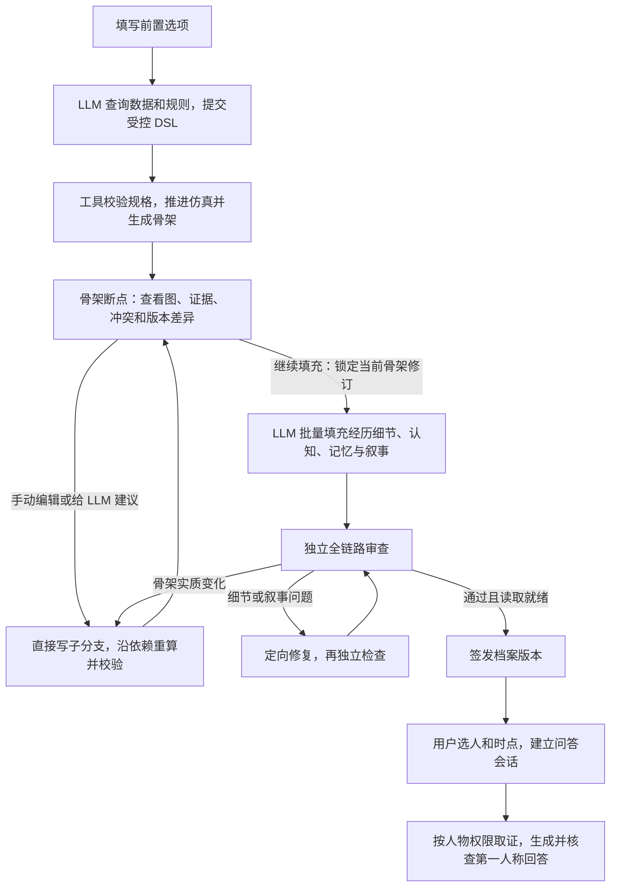

# LLM 人生生成与数字人问答设计

本设计将 LLM 放在整个人物生命周期中。它理解用户选项、调用工具生成骨架、按用户指示编辑骨架、填充人物细节、协助审查修复，并在档案库中以人物视角回答。项目工作流管理阶段推进和恢复，图账本保存人物事实与版本，领域工具提供抽样、历史约束、依赖重算和证据查询。本文与[全链路统一契约](全链路设计复核与统一契约.md)和[全链路流程图](全链路流程与数据流转图_2026-11-20.html)配套。

## 1. 用户看到的完整流程

交互入口提供生成选项、骨架审阅、扩写审查进度、数字人档案库及人物问答。骨架审阅显示时间轴和并行轨迹、关键关系、共享事件、证据和未知项，以及父子修订差异。用户可在同一界面编辑字段、锁定选项、要求 LLM 改某段人生，或查看修订对其他人物和后续轨迹的影响。确定需要调整时，手动编辑与 LLM 编辑走同一写入协议。自动结构校验通过后，用户点击**继续填充**并确认确切的图修订和扩写范围。生成期间若骨架结构发生修复，任务再次停在骨架审阅点，待用户重新确认所填充的图版本。

## 2. 从选项到候选骨架

- **选项编译。** 简单选项可由表单直接转换，LLM 把自然语言和补充选项整理为结构化生成规格。规格固定目的、`frame_id`、入口类型、地区和时期、参照日或观察截止、必须满足的条件、可调整偏好、未指定字段的策略、随机种子策略及世界、规则和参数包版本。每项显示来自用户、默认值或有依据的推导。缺少会改变总体、研究用途或角色权限的关键信息时先澄清，不猜测后再生成。约束不可同时满足时展示原因和受影响选项。缺口允许使用有标记的情景假设或保留未知。
- **工具编排。** LLM 查询目录、适用参数和历史规则，提交受控 DSL 并调用生成工具，再根据结构化结果解释和定位问题。DSL 以 JSON 表达字段、枚举、已登记机制及参数引用，由项目维护的 CUE 和派生 JSON Schema 校验。领域工具执行引用、时空、制度、资源、关系和状态约束。自由文本留在说明字段，运行器只解析受控字段及已登记的规则构件。[JSON Schema 2020-12](https://json-schema.org/draft/2020-12)
- **骨架生成。** 抽样工具确定人口和家庭入口，仿真适配器推进已校准的风险和竞争事件。LLM 可以补充候选机制和必要的图节点，并对工作分支直接修订。候选用 `candidate_id` 追踪，被采用的经历用 `event_id` 入图。未校准条件和用户指定的人生干预按场景记录。保留可审计的选择过程，只有符合研究总体、概率和权重条件的结果才用于该范围的统计推断。
- **初始校验。** 骨架附未决冲突、覆盖和粒度说明、共享事件影响及可重现运行引用。OpenM++ case-based 仍是仿真首轮概念验证候选，复用项目工具接口执行同一批反例。适用时可换接通过契约测试的仿真器。[骨架引擎选型](骨架生成DSL与仿真平台选型报告_2026-11-20.html)

## 3. 骨架断点、修订与恢复

| 状态 | 持久化结果和允许的推进 |
|---|---|
| 规格已锁定、骨架生成中 | 保存生成规格、入口、处理进度及实际工具输出，完成后写工作修订和结构诊断。 |
| 待骨架审阅 | 持久保存当前 `graph_revision_id` 和所见差异。手动编辑或授权 LLM 指令创建子分支草稿，沿依赖重算，回到此状态展示新修订。 |
| 填充中 | 继续请求绑定当前通过结构校验的骨架修订和幂等键，保存用户选定的版本。填充作业只读取该版本并按块写入可恢复结果。 |
| 全链路审查、修复中 | 独立检查记录问题和影响范围。纯细节修复生成内容新修订并复审。需要改骨架时转入子分支修订，完成重算后回到骨架断点。 |
| 待发布、档案就绪 | 按用途核对签发条件、版本清单和同版检索能力。就绪后档案库可选人、固定时点并发起会话。 |

骨架断点确认的是**下一阶段使用的版本**。编辑工具可以直接覆盖工作子分支，操作级校验和依赖重算按[统一契约 §5](全链路设计复核与统一契约.md#5-llm-直接编辑重算与并发语义)执行。刷新、退出或进程中断后可返回断点。并发编辑导致确认所用版本落后时，返回当前修订及差异供选择。重复继续返回既有作业。用户在填充期间开启新骨架修订时，新旧作业各自绑定输入。完成较晚的旧作业可以保存其产物，默认签发仍核对本次确认和预期发布指针。

## 4. LLM 填充血肉

每个扩写任务按生命阶段、事件簇或共享人物范围划分。任务包包含骨架修订、目标事件、前后状态、既有关系、人物当时的可见信息、可用证据和字段责任。系统先生成结构化细节，再据此组织叙事和可供问答使用的材料。

| 产物 | 写入及使用规则 |
|---|---|
| 经历细节 | 补充各阶段的日常安排、行动动机与具体处境，关联有效时间、`event_id`、参与者及生成依据。对状态或资源有实质影响的新增经历或子事件进入图修订通道。 |
| 认知与记忆 | 记录角色所知、何时获知、信念及后来如何回想。保存时间精度、置信或缺失，允许不同人物对同一事件有不同解释。 |
| 表达约定 | 从人物自己的教育、语言经历、年代、关系和情境提炼词汇、称谓、表达偏好、记忆线索与可披露边界。档案允许角色在不同关系和生命阶段表现不同。 |
| 叙事 | 使用图、细节及已授权视角生成摘要和片段，保留事实锚点。场景修辞和虚构对白标明合成叙事。 |

用 `detail_revision_id` 固定一组扩写内容，记录所依赖的 `graph_revision_id`、每块的输入摘要、受影响的事件或字段、模型与提示版本、校验结果和实际输出。共享事件由一组兼容的内容块交付，个人视角分别保存。重试复用相同任务键。某节点改变时按记录的依赖失效并重填被影响的块，连带更新记忆、摘要与索引。没有依据时可以生成情景表达、使用区间或保留未知。填充密度按用途和证据设定。

## 5. 全链路审查、修复和入库

1. **程序检查。** 从起始选项逐项回查，核对时序、粒度、关系、收支、资源、地点、时代制度、生死边界、版本和引用。检查拆分与汇总影响只结算一次。验证选项约束、人口口径和权重是否仍适用。
2. **独立语义审查。** 独立 LLM 审阅事件及其证据，检查细节能否从档案支持、时点知识是否正确、跨章节与多人视角有无冲突、口吻是否与人物经历相符。检查报告列出问题标识、严重度、证据引用、影响范围和建议修改。发布服务根据程序检查及所需审查结果判定。总体和问卷适用性依各自独立验证。
3. **定向修复。** 派生计算错则重算，情节或口吻错则重写相关内容块。涉及主干经历、关键关系、生命终点或用户确认的约束时，按图修订写入子分支并回骨架断点。每次修复有预算、前后差异和复验，反复出现的疑难问题保留具体冲突和待处理状态。
4. **版本签发。** 档案发布清单把 `person_id`、`release_id`、`graph_revision_id`、`detail_revision_id`、校验报告和同版检索产物绑定。图与细节可在发布之前暂存。通过校验及同版本读取探测时，短事务才切换默认可问答发布。全文或向量索引可后台构建，暂未就绪时使用同版的精确字段、时间线和关系查询。旧会话绑定旧快照，修订后的发布对新会话可见。

## 6. 档案问答如何像这个人

用户从档案库选人、选版本和人生时点。会话固定 `person_id`、`release_id`、图和细节修订、`snapshot_id`、查询及登记截止和说话者权限。默认使用所选发布中最近的可答时点。已故人物通过选定生前时点取得第一人称视角。会话内切换人物、时点或版本时建立新的视角会话。档案页面标识合成人物，聊天正文使用自然第一人称。

“让 LLM 像本人回答”在系统中实现为**受约束的第一人称角色模拟**：模型读取同一人物的稳定经历、当时知识、关系、表达特点与记忆，以合适视角组织语言。当前模型不因角色指令而成为该真人，也不能证明它具有这个人的意识或真实记忆。产品清楚标注回答来自合成档案，避免把沉浸感呈现为真人身份认证。

1. **确定视角和题意。** 先分辨是在问亲历、回忆、当时观点、现在的看法或假设。年份、角色或指代重要且不明确时先澄清。回顾旧事使用作答时点的记忆，切换到生前某年则使用该年的知识与处境。
2. **按需调用档案工具。** 服务端先按人物、发布、时间、知情和访问规则限制候选范围。LLM 可以定向取身份、事件、关系、处境、记忆、自述与语言例子。精确查询覆盖时间和规范字段，语义检索辅助找相关片段。空结果标明缺失语义，查询失败单列。关联人物的记录经角色权限过滤后才参与回答。
3. **建立人物视角。** 每轮注入稳定的人物身份与说话习惯、时点快照、当前关系和情境、问题相关的材料与有限会话摘要。按绑定画面与证据选择表达，用这个人会使用的词汇、记忆粒度、态度和披露方式回答。不同场景允许不同语气。稳定身份和动态状态都随档案版本提供。
4. **产出并核查。** 模型输出第一人称正文、可审计的依据引用、回答类型及必要的不确定性。服务端核对引用和所指陈述、版本与角色可见性。依据不足时可做一次定向补查，在适用情况下表达“我不记得具体哪一年”或说明推测。无依据的隐私推断、客观事实和未经确认的经历在检查中降级或移除。会话可以从档案页面查看所用时点与允许展示的依据，正文保持人物口吻。
5. **将对话保存为会话记录。** 人物事实、人物记忆与会话内用户提供的信息分别保存。用户在聊天中说“你那时已经搬家了”时，该句只作为提问语境。用户明确请求改档案时，单独建立编辑作业，按图修订、审查与发布路径执行。

例如用户问“你那年为什么没去外地上班？”，人物代理先找到当年的入职安排、照护冲突和这个人后来对此的回忆。如果档案支持入职延期并由本人承担照护，可答“那会儿我爸刚出院，我得留下陪他跑几趟医院。外地那边我先商量把报到往后挪，具体哪天记不准了。”如果陪诊只由兄弟实际完成，本人当时也未获知细节，答案须反映这人的角色和信息状态。

**自然问答与问卷共用人物证据查询。** 自然问答保存对话与引用。正式问卷另外绑定题本、选项、施测模式和作答状态，输出独立答卷并按任务验证。角色评测对事实、时点、口吻、态度和认知来源分别打分，也允许受证据支持的记忆差异。记忆检索、时间角色一致性和访谈评估可借鉴已有研究，项目可用性由自己的对照评测决定。[Generative Agents](https://arxiv.org/html/2304.03442) · [TimeChara](https://aclanthology.org/2024.findings-acl.197/) · [InCharacter](https://aclanthology.org/2024.acl-long.102/)

角色代理的身份连续、时点知识、检索行为和语言风格分别验收。记忆检索漏项、记忆虚构和模型习惯话术渗入均作为专门回归错误类型。关于生成代理的论文报告了这些失败模式，相关人物保真研究也明确区分个人性格保真与知识、语言特征复制。这些来源用于发现测试角度，其指标结果不直接迁移为本系统的目标值。[Generative Agents 的受控评估和错误分析](https://arxiv.org/html/2304.03442) · [ACL 2024 InCharacter](https://aclanthology.org/2024.acl-long.102/) · [TimeChara 时点幻觉评估](https://aclanthology.org/2024.findings-acl.197/)

## 7. 角色、工具和执行契约

| 执行角色 | 可调用能力 | 落库的主要结果 |
|---|---|---|
| 生成协调 LLM | 查询目录和覆盖、提交规格、启动受控仿真、读取校验结果 | 规格、运行清单和初始图 |
| 骨架编辑 LLM | 读取指定分支、提交结构化图操作、查询影响范围和校验 | 工作修订、差异与重算结果 |
| 细节生成 LLM | 读取已确认骨架及授权资料，提交内容块和结构变更说明 | 结构化细节、记忆、表达约定、叙事 |
| 独立审查 LLM | 读取固定待验收版本、运行证据检查、提交诊断 | 审查报告和定向修复建议 |
| 人物问答 LLM | 读取会话限定的人物快照、检索并取证、提交回答 | 第一人称答复、依据和会话记录 |

应用服务统一提供类型化工具。各工具登记适用阶段、权限、入参与出参、幂等策略、耗时和输出预算。工具执行前鉴权并固定请求版本，执行后记录可见结果和工具版本。工具取回的历史文本、用户文本以及档案片段均以数据交给模型。程序保护角色和版本边界。可审计记录保存经过授权的输入、模型与提示版本、工具摘要、实际产物和简明诊断。可相互替换的模型路由按结构化调用能力、人物口吻、事实准确性、时延和成本评估。制作、审查和问答各有独立上下文。独立审查从锁定的待验收版本重新装载，不把生成模型“自评通过”当作证据，并与程序检查和来源核验共同判断。审核模型可以独立选路由，但仅更换模型并不自动构成独立验证。

| 工作流阶段 | LLM 可调用的工具范围 | 禁止的越权作用 |
|---|---|---|
| 规格整理 | `catalog.list_options`、`population.get_frames`、`source.search`、`parameter.resolve`、`generation_spec.validate` | 把某历史来源直接当作个人经历；自己补造无来源风险参数 |
| 骨架生成 | `skeleton.start_run`、`skeleton.get_status`、`graph.read`、`graph.validate` | 生成模型源码；读取无权访问的微观样本 |
| 断点修订 | `graph.read`、`graph.edit`、`graph.diff`、`graph.recompute`、`graph.validate` | 绕过父修订、幂等和校验；静默合并冲突来源 |
| 血肉填充 | `detail.read_sources`、`detail.write_chunk`、`detail.get_status`、`detail.validate_anchors` | 以叙事细节隐式新增人生事件或状态变化 |
| 独立审查 | `review.load_release_candidate`、`review.check_rules`、`review.check_evidence`、`review.write_findings` | 自行发布；以流畅或典型证明个体经历和概率正确 |
| 修复与发布 | `repair.target_chunk`、`repair.propose_graph_change`、`review.recheck`、`release.prepare`、`release.publish` | 跳过未解决审查项；将新图与旧索引混合发布 |
| 数字人问答 | `persona.get_snapshot`、`persona.search_events`、`persona.search_relations`、`persona.search_memories`、`persona.search_details`、`answer.validate_claims`、`conversation.append_turn` | 访问所选发布或角色范围以外的数据；将普通聊天写回人物事实 |

能力注册表根据阶段、调用者权限、所选 release 和任务用途生成逐请求可用工具集。未注册的查询由工具服务拒绝，返回可见错误原因。生成、填充、审查和问答可独立路由到具备所需能力的模型配置，也可在成本或供应条件下共用底层模型，但调用提示、状态、工具、输出契约与发布权限仍按责任隔离。模型和提示变更进入回归集。

## 8. 贯通验收

| 用例 | 通过标准 |
|---|---|
| 冲突选项与随机抽样 | 佐证日期、年龄与政策冲突能定位。用户指定条件有来源标记，概率不足的结果保留情景用途。 |
| 人工编辑与 LLM 直接编辑 | 两者生成同类图操作和可回放差异。签约月份改变后，入住、通勤和陪诊按依赖重算，旧版旧答卷可复查。 |
| 暂停、重复继续和并发 | 刷新后恢复同一骨架断点，重复点击复用作业，确认旧修订时显示差异。过期作业无法切换发布。 |
| 血肉的部分失败和审查 | 内容块可重试与复用。伪造事件、未来知识、关系混线和冲突叙事能定位。主干修复返回断点，局部修复独立复验。 |
| 归档和查询就绪 | 重试、进程中断或后台索引延迟下，档案库所选档案只读取同一发布包。按明确版本回放。 |
| 多轮答话与视角变化 | 同一事实改写提问、跨轮追问、错误前提、无答案、隐私、已故生前回放和版本切换分别测试。事实一致，符合角色的披露、语气与记忆差异都可出现。 |
| 问答像本人 | 同一批问题盲比静态人设、结构化档案与完整工具检索。记录事实准确、虚构个人经历率、错人错时率、未知处理、口吻一致性和多轮矛盾率。问卷保持单独验收。 |

首轮验证以一个含迁居、就业与家庭照护的合成人物贯通全部阶段，审查后签发并使用问答工具实测。规模化再验个体数量、不同人生时段、群体切片、检索延迟、模型成本与审查修复率。本文记录设计契约，真实运行指标由概念验证取得。
