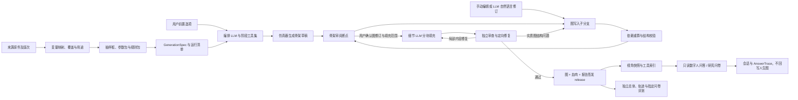

# 虚拟人生成系统全链路设计复核与统一契约

设计复核日为 2026-11-20。本文件规定跨模块的对象、标识、时间、版本、运行和验收口径。设计图卷用于浏览和演示，设计基线及各专题文件提供领域细节。跨模块接口以本文为准。统计口径和历史事实按专题所列来源、时期和数据版本核对。

[全链路流程与数据流转图](全链路流程与数据流转图_2026-11-20.html)提供领域及生命周期流程图。[LLM 人生生成与数字人问答设计](LLM人生生成与数字人问答设计.md)补充大模型在规格编译、骨架断点、细节填充、审查修复和人物视角问答中的职责与限制。

## 1. 从交付结果反推设计

系统交付可编辑、可查询、可回放的合成人物人生图，以及带独立证据的限定用途发布结果。每次需要回答四个问题。

| 要回答的问题 | 最小交付与可反驳条件 |
|---|---|
| 这个人在特定时点经历过什么？ | 带准确时间粒度的共享事件、持续状态、参与者与资源影响。从同一图修订重建快照时，关系、时间、资源及生死约束应一致。 |
| 这个人物从什么总体、条件和随机机制产生？ | 抽样框、抽样单位、条件、权重、风险集、政策版和运行清单。两个相同边际假设产生不同家庭结构时，需比较联合分布与敏感性。 |
| 此人当时能知道、记得与愿意说什么？ | 作答者、题目版本、作答时点、参照期、知情与披露规则。旧时点收到后来的知识，或模型失败被计作拒答，均为回归失败。 |
| 修改节点后，哪些人、事件、状态和用途会改变？ | 新分支、变更与派生记录、失效范围、重算结果和验收状态。可快照回读原版，且未受影响的记录保留原引用。 |

设计完整性按对象和机制覆盖衡量。数据覆盖按时期、地区、总体、群体、主题及可用粒度衡量。实证效度按用途和独立证据衡量。三者分别出具结果。

## 2. 全部设计的复核与取舍

| 审查对象 | 两种立场各自解决的问题 | 决策及推翻条件 |
|---|---|---|
| 总体与抽样 | 广泛覆盖便于表达少见或缺档的人生，严格抽样框提供可解释分母 | 维持全地区、全民族的表达目标。大陆、港澳台和跨境人口按相应口径建立抽样框。合框须核对重叠、纳入条件和权重。稀疏格可表达场景，统计结论须通过相应格的独立验收。 |
| 维度与日常 | 统一量化有利于索引与对照，生活事实同时含计量、类别、区间和主观经验 | 55 个维度族、440 条一级概念作为字典。使用独立的事件、持续状态、关系、观察、记忆和答卷实例。给长期轨迹保存有依据的普通日程和时空资源；业务所需粒度再细化。初始化与细化前后均检查有效范围和总量。 |
| 历史和个人能动性 | 宏观制度或冲击缩小机会集，同处境者仍有不同资源、获知和反应 | 69 个历史节点与 69 条推演规则走“时空适用与制度资格 → 供给、暴露和知情 → 候选机制 → 尝试、未行动或结果 → 状态影响”。26 个主题案例与 2 条跨节点履历用于机制验收。负控要求未命中暴露渠道时，相关个人归因和增量消失，普通生活继续。 |
| 人格、认知与叙事 | 稳定倾向支持同一人物一致性，身体、社会处境、记忆偏差会改变表现 | 保存慢变倾向、即时状态、角色目标、事实、不同人的信念与回忆。用同人跨场景和异人同场景对照。心理量表按经过验证的版本与群体解释，哲学和民族志提供构念与反例，统计参数另取实证来源。 |
| 图、年表与关系 | 年表便于顺序浏览，部分序与并行轨迹能表达不确定顺序和共享事实 | 人生事件图从账本投影。时间、拆分、执行依赖和因果假设使用不同关系。年表是可查询的视图，独立人物卡上的同一共享事件引用同一记录。 |
| 生成与纠偏 | 模型按条件分布和风险推进，LLM 能扩写成真实可读的处境并修订局部 | 仿真器推进可校准过程，LLM 直接编辑图工作分支。结构校验与事实、证据和概率验证分开报告。修订所得若改变统计权重适用条件，重评该分支或改归情景用途。 |
| 共享事件与细化 | 可逐人阅读，也要保持家庭或机构的一次实际行动 | 共享事件用一个 `event_id` 和多参与方增量。粗粒度拆分后，父节点保留稳定导航，核对每笔增量的唯一计账主体。个体模式使用确定的 case 边界，跨 case 互动采用另行校准的总体模式。 |
| 时间与版本 | 档案更正提高当前准确度，历史回放须重建当时状态和知情范围 | 有效时间、档案登记时间、知情时间和作答时间具有独立语义。编辑分支、续写分支、情景和反事实通过父修订引用组织。原发布快照可按版本回放。 |
| 事件类型与生成粒度 | 通用事件表容易接纳新经历，落到账本时不同事件对状态和资源的含义不同 | 事件类型登记参与角色、时间粒度、前置条件、影响字段、依赖、终止条件和验收用例。就业入职、疾病发现和医费支付各用自己的规则。已有 69 个历史节点属于外部规则入口，个人事件类型按过程模块演进。 |
| 问卷与发布 | 丰富履历能改善个案语境，也可能引入模型先验和刻板模式 | 用同一总体和问卷口径比较人口标签、统计基线、结构履历、记忆检索和叙事增量。发布绑定具体验收声明，独立核对分布、关联、轨迹、子群、拒答和待测问题。实证比较的设计依据见 [PNAS 统计真实性评测](https://doi.org/10.1073/pnas.2538145123) 与 [Bisbee 等的问卷对照](https://doi.org/10.1017/pan.2024.5)。 |
| 技术与运行 | 领域仿真器缩短研发周期，自持契约降低对单引擎恢复和分支语义的依赖 | 先验证 OpenM++ case-based，项目持有图、校验、版本与恢复契约。用同一反例集比较独立参考实现，按正确性、可维护性、成本与性能决定投入。 |
| 仿真步长 | 年度状态模型便于使用低频资料，连续时间机制能保留事件竞争、时点约束与持续时间 | 按模块证据粒度选择。低频转移使用相应的区间或年度参数，确定日期的政策和事件保留日历约束。只在数据与机制支持时估计更细的发生时点，无须给全年状态制造逐日变化。 |

各专题的审查入口为 [研究型设计基线](虚拟人生成系统研究型设计基线_v3.0.md)、[维度字典与逐族生成契约](维度体系说明.md)、[数据来源与覆盖](数据来源与覆盖矩阵.md)、[历史节点目录](历史节点与环境暴露目录.md)、[历史推演与验收](历史暴露推演与个人路径机制规范_v1.md)、[跨学科机制](跨学科依据与机制补全.md)、[问卷验收](问卷模拟证据与验收方案.md)和[技术选型](骨架生成DSL与仿真平台选型报告_2026-11-20.html)。从页面查看各部分的关系可打开[虚拟人系统设计图卷](../../虚拟人系统设计图卷.html)。

## 3. 统一术语、标识和时间

| 统一名称 | 标识与语义 |
|---|---|
| 维度、维度族 | `dim_id`、`family_id` 是字典定义键。一个维度可映射到多主体、多时点的记录，既有键保持稳定，变更定义记录字典版次与迁移映射。 |
| 人物、家庭户、关联关系 | `person_id`、`household_id`、`relationship_id` 标识对象。亲属、同住、户籍、资产和照料分别记录角色与有效期。跨分支身份复用受分支祖先约束。 |
| 历史节点、环境快照、暴露记录 | `historical_node_id` 标识来源目录中的外部事件或政策。环境快照按 `world_version`、地点和有效时点解析外部状态。暴露记录标识某人或关联方经何渠道接触，引用历史节点及版次。 |
| 事件候选 | `candidate_id` 标识某风险集或机制中的可选项。候选可失效、未采用或对应无变化。只有实际创建分支才分配独立的 `branch_id`。 |
| 人生事件、持续轨迹、状态增量 | `event_id` 唯一标识一次合成经历或汇总锚点。一次经历的不同投影都引用该键。持续轨迹（LifeSpell）记录某状态有效区间。状态增量（StateDelta）以事件、参与者、字段与效果键唯一定位影响。 |
| 人生事件图 | LifeGraph 是人物或关联 case 的事件及关系视图。`graph_id` 标识图，`graph_revision_id` 标识图的一次不可变修订，`parent_revision_id` 指向主父修订，合并记录另保留来源修订。实现可存增量，指定修订须能得到完整、同版的读视图。 |
| 分支、情景、发布 | `branch_id` 标识可演进的版本分支，`scenario_id` 仅给条件情景和反事实的实验定义，`release_id` 锁定已签发修订或样本集合及适用范围。修订、续写、情景和反事实分别记录变更类型。 |
| 查询快照、人物视角 | `snapshot_id` 锁定图修订、查询时间、登记截止及视图用途等投影口径。人物视角还绑定说话者、所知内容和披露范围。受限投影缓存键须包含授权范围和版本。 |
| 来源、断言、观测和叙事 | `source_id` 及版次标识原材料。断言标识来源支持或反驳的命题，观测记录测量者、工具和误差。合成节点、人物回忆与生成叙事引用相应断言或事件，来源链记录输入、活动和责任主体。可按需映射至 [W3C PROV 数据模型](https://www.w3.org/TR/prov-dm/)。 |
| 执行记录与模式版本 | `run_id` 标识一次执行，`schema_version` 标识数据结构。运行清单另锁定世界、来源、字典、规则、参数、引擎和 LLM 配置版本。 |

世界目录和人生事件使用各自的标识命名空间。图示的顶点可用类型和标识组成引用。旧文档或示例的世界 `node_id` 映射到 `historical_node_id`，人生 `node_id` 映射到 `event_id`，旧人物版本语义通过图修订与投影恢复。记录版次、族语义或事件身份发生实质变化时保存映射，旧引用按记录所在模式版本解析。

| 时间字段 | 使用口径 |
|---|---|
| `reference_date`、`observation_end` | 前者为总体参照时点，后者为人生档案或观测随访截止。现时活人入口可能二者相同，出生队列和随访可不同。 |
| `valid_time`、`as_of` | 前者为事实发生或适用的时间，后者为待查询的有效时点。区分瞬时事件、状态有效区间及不确定的日期上下界，保留历法、时区、粒度和开闭边界。 |
| `recorded_at`、`archive_as_of` | 前者为系统登记时点，后者限制档案查询可使用的登记记录。指定历史修订时以该版仍可见的记录为基础。 |
| `known_at` | 针对特定人物与信息项记录获知时间、渠道、内容和置信。公布、生效、地方落实、报账和个人获知分别记录。 |
| `response_at`、`reference_window` | 前者锁定说话者代理的状态、记忆与施测语境，后者锁定题目询问的有效时期。 |

严格先后关系形成有向无环部分序。重叠、并行、时间包含及未定先后表达区间关系。单纯时间相邻与因果假设分别存储。内部调度若需对确定的同一时点排序，按领域优先级与稳定键排序，显示层保留原精度。来源不确定的时间使用窗口判定与条件结果。年龄跨资格阈值时可输出多个可行结论。

每项断言的适用性、合成世界确定性、观测状态、人物认知、来源类别和访问权限分别记录。比如某次迁居在此分支成立，月份未知，家属未获知，本人拒答，且某研究者无权访问。这些状态可同时成立。

## 4. 数据进入账本及发布的链路

1. **采录和版本化。** 登记来源原件或可核定位符、版本、摘要或哈希、采录时点、统计时点、资料粒度、访问和可用范围、来源状态及复核记录。规范条文、地方执行、宏观数值、测量记录与经验机制各保留自己的证据角色。限制使用的微观材料在受控计算环境内转换，发布经许可的参数和可追溯引用。
2. **统一口径。** 变量映射保存原始码、标准码、单位、转换、地理与分类有效期、缺口和损失。覆盖单元为抽样框 × 时期 × 辖区 × 群体 × 主题 × 指标口径。同一证据包分别标记边际、同人或同户联合、纵向转移、制度事实、机制假设和问卷适用性。结构零、样本零、数据抑制、未观察与数据缺乏分别处理。
3. **生成参数包。** 每个参数有 `parameter_set_id`、版次、输入映射、适用风险集和分母、估计器/代码版本、单位或时间尺度、估计不确定性、回退层级、检验结果和用途。竞争风险保留各转移的强度和时间单位。公开边际可以用于重加权，联合结构及转移另做独立检验。外推跨越覆盖单元时记录假设与敏感性。
4. **建立抽样与输出单位。** 明确抽样单位、case 模拟边界、输出单位、估计单位与相互对应的聚类信息。出生队列正向推进。参照日存活截面生成的是以生存和纳入条件为条件的前史，验证带权条件抽样、数据锚定或其他条件化方法，保存有效样本量与选择机制。死亡档案按死亡发生、登记、覆盖和纳入条件构建。指定体验、稀有情形或无总体分母的样例按情景发布。
5. **保存权重及选样过程。** 源抽样权重、校准后分析权重、合成抽样概率和情景权重分字段。记录拒绝、修复、合并、删失、重抽和未处理比例及所属切片。涉及家庭样本按家户和个人需要各自估计，避免重复采计亲属。编辑使某人失去原风险集、参照日资格或抽样框条件时，标记受影响权重并重验。
6. **推进和签发。** 先应用时空机会及人物条件约束，维护状态区间、风险集和竞争队列。对命中的候选核对意愿、行动和结果，再按共享事件写入账本。发布清单锁定输入版本、实际产物、取样凭据、规则与验收状态。保留弱证据和覆盖缺口，允许结构可用而某用途未验证。

### 4.1 LLM 生命周期

调用方把生成选项编译为有版本的 `GenerationSpec`。规格同时保存来源，并将要求分类为强约束、偏好或默认值，完成授权、字段、枚举和相互冲突检查后，LLM 才经当前版本的能力工具集查询参数、规则和总体覆盖并发起模拟。DSL 是声明式的有类型数据，不能包含运行模型源码、任意 SQL 或 shell。

人物生成作业以固定 `run_id` 和幂等命令推进以下状态。相同命令在重试时读取原作业结果。骨架审阅状态是交给用户检查和决定后续填充的正式断点。

| 作业状态 | 输入与动作 | 输出与允许的下一步 |
|---|---|---|
| `request_received` | 选择的用户选项和研究用途 | 存下原始选择，进入规格整理 |
| `spec_ready` | 已校验的 GenerationSpec、调用权限、总体与参数版次 | 请求缺失时返回选项或约束原因，不启动仿真 |
| `skeleton_running` | 固定规格和随机策略，调度样本构建及仿真工具 | 留下实际结果或有分类的错误，完成后生成工作图 |
| `skeleton_review` | 可读的图快照、数据覆盖、约束结果、未知项和受影响范围 | 用户可编辑、命令 LLM 修订、回滚草稿或明确继续 |
| `flesh_running` | 用户确认的确定性图修订、细节规格、内容模型版本 | 创建分块的血肉草稿，保存固定依赖和任务状态 |
| `chain_review` | 图、血肉、证据、关系、角色、时间和权限一致性 | 独立校验结果及定位到事件和内容块的问题清单 |
| `repair_loop` | 缺陷位置、影响集、允许的修复类型和循环预算 | 局部修复并复验，或图级变更返回骨架审阅 |
| `publish_pending` | 已通过所需检查的完整图、内容、索引与发布清单 | 预备同一 release 的档案视图和精确读取端点 |
| `ready` | 清单和精确读取冒烟测试通过 | 档案库可选，问答端能固定到具体发布和视角 |
| `failed / cancelled / needs_attention` | 分类错误或未自动解决的缺口 | 保留部分产物和修复位置，不签发混合或未验证版本 |

LLM 提出的骨架改动不需要逐项人工批准才能写入工作子分支，但必须沿父修订创建、保存差异并通过图校验。用户可先以自然语言指导 LLM 改，也可直接手工编辑。用户从骨架断点点击继续时，确认确切的已通过结构校验的 `graph_revision_id` 及本次填充范围。任何后续结构修复产生新图修订后，必须再次确认骨架断点才恢复填充。填写期间重复点击、超时重试和客户端重连均沿原幂等作业继续。正式问答中发生的普通聊天不重跑生成工作流。

### 4.2 血肉、审查与档案发布

骨架中的实际经历、状态、关系和因果假设与内容扩写分开持久化。每个 Detail/Memory/Narrative 块引用所依赖的 `event_id`、`graph_revision_id`、内容版次、来源和模型版本，并用幂等键分块保存。情绪、动机和回忆是人物视角内容，不能自动反写客观事件字段。扩写时发现改变人生路径的新事件，转入骨架修订闭环。

全链路审查分别检查图结构、时间与覆盖、事实和来源、跨人物共享资源、细节锚定、人物信息边界、章节及跨块一致性。确定性检查负责规则和引用。独立审查模型可解释问题与提出修复。生成调用不单独签发自身产物。主干图有改动时重新确定 `graph_revision_id`、重算并重填受影响块；只改叙事时产生新的 `detail_revision_id`。每轮修复记录问题、差异及复验，额度耗尽则标出未解决状态。

档案发布清单将图、血肉、运行清单、验收报告和检索视图绑定同一 `release_id`。已签发图可作为校验通过的修订，同时仍具有当前“待填充/待审查/待发布”人物档案状态。只有发布清单通过所需验收，且档案所依赖的精确字段、事件、关系和细节查询可用时，角色问答才能选用。语义向量索引可异步优化，但请求只能查询相同 release，可先精确搜索，或标记功能暂不可用；禁止把新图和旧索引拼成貌似完整的档案。

### 4.3 风险集和时序推进

处理竞争风险时，以进入某状态的人与暴露时长定义风险集。若同一窗口内的各原因强度可视为常量，发生任一退出的概率为 `1 − exp(−Σλₖ × Δt)`，退出时按各原因强度占总强度的比例分配。在迁居、政策生效、获得照护或其他条件改变时分段重新计算。确定时点的安排、没有发生任何退出的概率和多个可并行过程各自保留。将不同原因的区间概率直接相加可能破坏总概率，依靠年度资料推连续风险时需登记换算假设。[多状态分析与竞争风险原文](https://www.est.ufmg.br/~enricoc/pdf/sobre/Putter2007.pdf)

## 5. LLM 直接编辑、重算与并发语义

LLM 通过有写权限的图编辑接口执行新增、修改、拆分、合并或撤销操作，一次调用可提交一组相互依赖的编辑。它的操作直接改写新工作分支的合成记录，无需人工作出接受决定。父修订保留有效内容和引用。撤销在子分支的有效图中移除该记录，同时保存撤销依据。

| 顺序 | 执行约定 |
|---|---|
| 1. 建立修订 | 接收基准修订、操作、目标事件、原因、来源引用和幂等键。服务端核对主体和字段权限、类型、当前引用与重复请求。以父修订为基准创建子分支的工作修订。退化为纯叙事补写时，只失效引用该叙事的派生内容。 |
| 2. 解析语义与冲突 | 核对事实或假设、原始来源、共同事件身份、时间和共享资源。独立校验器给出结构冲突、硬约束、证据不足、概率偏移或来源争议。制度资格和实际经历分开，违规、漏发、延期和拒绝各自保存。可自动修正的派生差分重新计算。LLM 可直接修订或撤销合成内容。外部断言以新增、撤回或补充版本表示，来源冲突保留证据链。 |
| 3. 定位影响范围 | 追踪事件、字段、时点查询、候选规则及共享主体对上游输入的依赖。包含旧关系和新关系、撤销前后的时空范围、资源竞争者及“当时查无记录”的选择；新增迁居也可能使原本未知的资格关系生效。重新取依赖直到影响闭包稳定。不能证明局部有效时扩大至同一共享 case 的受影响时段。 |
| 4. 重算后继 | 从变动可能生效的最早边界前恢复可核状态，含待决事件、资源余额、关系、参数、知识与随机地址；缺乏可用检查点时按冻结输入与明确编辑约束回算。按依赖拓扑更新候选和状态；时间不确定或共享资源竞争由受影响的一组计算统一求解。失效的旧猜测、摘要、索引和适用权重更新对应投影。 |
| 5. 形成可用新版本 | 记录父子修订、增删改集合、未改对象引用、规则与参数版、前缀核对及校验结果。原子保存同一个共享事件、参与者和各自状态增量并切换发布指针。失败草稿可继续修，默认读路径取最近一次已通过的已发布快照。 |

工作修订持久化后可按修订标识读取。重算改变图内容时，在同一子分支追加不可变修订，保留原编辑版本。签发指向通过检验的完整修订。一次命令可用父修订、操作与预期值表达同一批编辑，返回工作修订、作业标识和处理状态，最终结果返回可用修订、差异与诊断。合成事件的显式修改或撤销作为复算输入固定。若重算无法同时满足修改和硬约束，保留工作结果及冲突定位，后续由编辑接口提交新修订。

依赖图的节点标识具体的事件、状态字段、查询或可重复运行的计算，边表示可追查的输入依赖。共享日程或资源分配需要联立时，将相关变量作为一个计算单元求解。计算单元之间保持无环，跨时点反馈以各时点的节点和依赖表达。约束求解结果保留可行、不可行和未确定。未确定时记录超时或输入不足，并保留受影响字段的验证状态。

运行时以基准修订和预期发布指针实施乐观并发控制。同一幂等键绑定请求内容与结果，不同内容复用同一键视为冲突。并发操作分别形成可追踪的子分支，合并须核对共同祖先、读写语义和依赖范围。共享事件或资源发生竞争时重新读取、重算与校验。长时计算置于事务外执行，提交时核对输入和发布指针。一致性涉及同一快照的多行查询时，采用明确锁定或可串行化事务并重试序列化失败。发布事件通过同事务出站记录投递，投递及消费支持去重。[PostgreSQL 事务隔离](https://www.postgresql.org/docs/current/transaction-iso.html)

粗事件细化后保留 `event_id` 作汇总锚点，子事件分配各自身份，细化关系无环。父节点转为纯汇总时，原有实际影响要迁移到对应子事件并通过资源及频数核对。部分细化可将未展开影响单独保留在一个明确计账的事件上。共享的子事件在亲属视图中继续引用同一记录。对状态改变的细化须重算后继，记忆、对话与语气受人物知情和时点约束。

**回放、复算与反事实比较。** 回放读取已存产物，因此保留原始 LLM 输出、经接受编辑、引用及内容摘要或校验标识。确定性复算在锁定代码、输入、平台数值口径时比较事件集合及状态差分。反事实比较对可配对的过程复用随机地址，用于降低比较方差。随机地址按 case、对象、过程、风险时窗或稳定决策键与用途命名。避免使用修订 ID、临时遍历序号和线程号当共同随机地址。OpenM++ 的实体本地随机流是顺序随机流，事件增减仍可能改变同一流的抽取次序。项目验证精确重现与跨分支配对分别达标，计数式随机数是一种可选实现。[OpenM++ 本地随机流](https://github.com/openmpp/openmpp.github.io/wiki/Local-Random-Streams) · [Random123 原论文](https://www.thesalmons.org/john/random123/papers/random123sc11.pdf)

**生命周期。** 在世人物从观测截止继续，未来按指定假设建分支。已故档案允许补录和更正生前事实，遗产、追忆和身后记录归对应行动主体。发生顺序与已知事实冲突时重新检验受影响的生前快照。历史作答和现在继续运行各自绑定适用的生命状态。

## 6. 技术选型与运行方式

| 层 | 默认设计 | 何时改变 |
|---|---|---|
| 概率过程内核 | OpenM++ case-based 为首个 PoC 候选。可信模型实现竞争风险与关联实体推进。通过项目适配层交换参数、稳定对象标识和明确的事件输出。独立小型离散事件参考实现用于对照关键机制。 | 当案例间确有受测的持续外部性再验证 time-based。若 OpenM++ 无法按约束注入编辑、导出关联状态或复算锚定前缀，对照 Ixa 或自持离散事件内核并量化代价。 |
| 描述契约 | 项目持有版本化图和操作语义。CUE 是内部字段及约束声明的维护来源，JSON 是交换格式，JSON Schema 可从受支持的约束子集生成并做等价用例检查。 | 跨对象引用、图无环、跨修订状态和资源一致性由领域验证器检查。需要独立维护地方谓词时接入受限 CEL，只有出现实际排程或资源可行性子问题时引入 CP-SAT 等求解器。 |
| 事务账本与数据制品 | 多写者运行用 PostgreSQL 存版本、事件、关系、增量、依赖索引和发布事务。较大来源、批次输出与实际 LLM 产物按许可和内容摘要管理。建立可复建的快照与索引。 | SQLite 可做单写者机制原型。图查询中大量多跳访问或全文/向量检索需要时按实测增加读模型，账本仍为事实依据。 |
| 执行和发布 | 初期采用明确边界的模块化服务与批量 worker。每个作业按输入版本、幂等键、重试类别、状态及实际输出审计。发布可按范围切换到新的已签发修订，回退指针时保留期间所有版本。 | 需要跨进程长流程及故障恢复时引入持久工作流。工作流可恢复执行任务，历史事实和依赖重算遵循图版本契约。 |
| 下游读取 | 问卷调用固定发布、图修订、查询快照、角色和作答时点。按字段/时间先裁剪，再做语义检索及引用检查。匿名或权限外片段在检索和发布均需过滤。 | 延迟、批量吞吐或多项目隔离成为瓶颈时拆独立读服务，验证版本与授权缓存不会复用到其他调用。 |

执行按首次生成、编辑重算、续写、情景或反事实、只读回放区分。首次生成和续写推进风险过程，编辑重算接受改动并固定相容的父版本前缀，情景与反事实锁定介入条件及比较对象，只读回放加载实际发布产物。所有写模式共享图修订契约。计算结果保存为待校验、需纠偏、可发布或已发布状态，使用者可查询作业是否仍在计算。输入修订、规则或模型升级后，以原有版本启动差异评估，依影响范围重新校准。

工作进程按 case 或显式声明的关联组分区。重试沿用同一幂等键，区分临时运行故障、永久输入错误、规则冲突和证据缺口。前两类分别重试或修复输入，后两类产生诊断，等待直接修订或证据增补。运行观测按版本、入口及群体切片列出失败率、完成时延、重算范围、改写次数、模型调用成本和索引延迟。比如队列恢复成功而共享事件重复入账，仍按事务用例失败处理。恢复演练从发布清单回读，再依据账本重建索引与快照并核对版本引用。

官方材料确认 OpenM++ 支持分析用的 case-based 与 time-based 模型、实体随机流和配置微数据输出。其公开的 RestartController 面向既有运行中未完成的 sub-values，任意人生时点的完整队列恢复、按外部编辑约束回算、跨实体所有影响的捕获均须由项目实测。CUE 的结构验证和 JSON Schema 导出有各自的表达边界，训练/开发使用同一正负用例核对可交换约束。[OpenM++ 模型规模](https://github.com/openmpp/openmpp.github.io/wiki/Population-Size-and-Scaling) · [微数据输出](https://github.com/openmpp/openmpp.github.io/wiki/Microdata-Output) · [运行重启](https://openmpp.org/libopenm_doxygen/html/classopenm_1_1_restart_controller.html) · [CUE 与 JSON Schema](https://cuelang.org/docs/concept/how-cue-works-with-json-schema/)

## 7. 问卷与反例验收

一次作答记录锁定目标人 `subject_person_id`、实际说话者 `respondent_person_id`、图版本及 `snapshot_id`、题目/选项编码及顺序、施测语言和方式、参照期、作答时点、先前会话摘要和可披露依据。施测状态记录资格、跳题、呈现情况，回答状态记录已答、未知、记不清、无意见、拒答、主动中断和未产生作答，执行状态单列成功、阻断、超时及失败。随机抽样对照用固定样本路径和调查条件，实际答案以新观察记录保存。

检索沿用 L0–L3。效度用 V0 结构、V1 逻辑、V2 总体、V3 轨迹、V4 指定问卷任务标识，对应旧版同序验收级别。每个用途登记必需的指标和证据范围，保留各项通过、失败、未验证和不可评估的状态。群体结论不得由某条图的结构检查重新评级。留出按目标推断确定独立单元，记录跨波次人物、家庭、样本簇、派生数据及基础模型可能见过的公开材料。明确同人纵向留出和独立人群外推的不同估计目标。

| 最小反例 | 设计通过标准 |
|---|---|
| 样本框 | 同一出生队列分别走出生入口、存活入口、死亡档案入口。核对各自分母、死亡率、删失和追踪权重，小样本同时核对失败或重抽切片。 |
| 历史政策与知情 | 同一政策设不同公布、生效、到账、获知与登记日。早期角色所见和后补的研究档案结果具有独立时间语义。 |
| 直接编辑及分支 | 给已发布版本的一个家庭改搬迁日期或撤销签约。新分支变化可查，旧分支与原问卷结果可重复读回。检查任务超时、求解结果未定与草稿校验失败各自可定位。 |
| 父子记账与依赖发现 | 把一次迁居拆为签约、运输、入住。核对合计开支与搬迁次数。新增的地址应重新触发与原未命中资格、通学、照护和通勤有关的检查。无关联的既有事件保持旧引用。 |
| 共享事件并发和崩溃 | 两个请求同时修订同一陪诊与家庭支付，另测提交后停止投递再恢复。同一修订内各方状态同版，金额和时段只计算一次，重试用同一操作结果。 |
| 复算与模拟器选择 | 同输入重跑、打乱任务顺序、插入独立事件、更改共同前缀后的条件，分别比较可配对随机地址、旧前缀、受影响路径及候选分布。用小型参考模型核对竞争风险和连接实体输出。 |
| 权限和死后边界 | 改变角色、图版本和查询时点，核对死后当前作答、代答及生前回放。跨亲属、索引、摘要、导出和会话引用均按同一作用域检查。 |
| 调查效度和漂移 | 用独立真人留出样本做统计基线与履历增量消融，按任务预定误差限、主指标、群体和最小信息量。系统错误、拒答、尾部、关联及轨迹差异分别报告。 |

项目 PoC 的第一条贯通路径选取合成家庭的迁居和陪诊。父版设定 5 月签约、6 月实际搬入，某子女因此改乘同城线路陪诊。LLM 直接改签约时点到 7 月时，子分支须重验此前搬入的条件，重算住处、通勤、排班、照护和费用，或记录无法消解的冲突。父版的归档快照和旧问卷仍以原引用读取。无关联的教育轨迹可按原引用复用。生成概率和群体评测分别使用有权限且适用的参数与独立样本。PoC 输出记录平台、构建、参数、规则、样本、资源、吞吐和观测指标，阈值按项目负载与研究目标确定。

引擎对照使用同一输入、操作、资源约束和输出断言。先核对生死、共享事件、条件前史、固定编辑和可回放的硬条件，再测单 case、交互编辑和批量模式下的延迟分位数、吞吐、峰值内存、重跑比例、存储写入和维护代价。兼容的实现可在同一契约下替换，跨模型、版本或平台的比较须注明采用逐事件一致、数值容差或分布等价中的哪项判据。

## 8. 当前证据与未完成验证

这轮完成文档设计与接口复核。OpenM++ 的工程适配、精确恢复、规模并发、单位成本和多平台数值一致性待按第 7 节实测。人口联合分布、历史地方细节和转移参数按数据矩阵分期补证。首次独立问卷验证仍需要目标总体、许可样本、题组和预注册误差限。发布声明以相应证据项通过为准。
